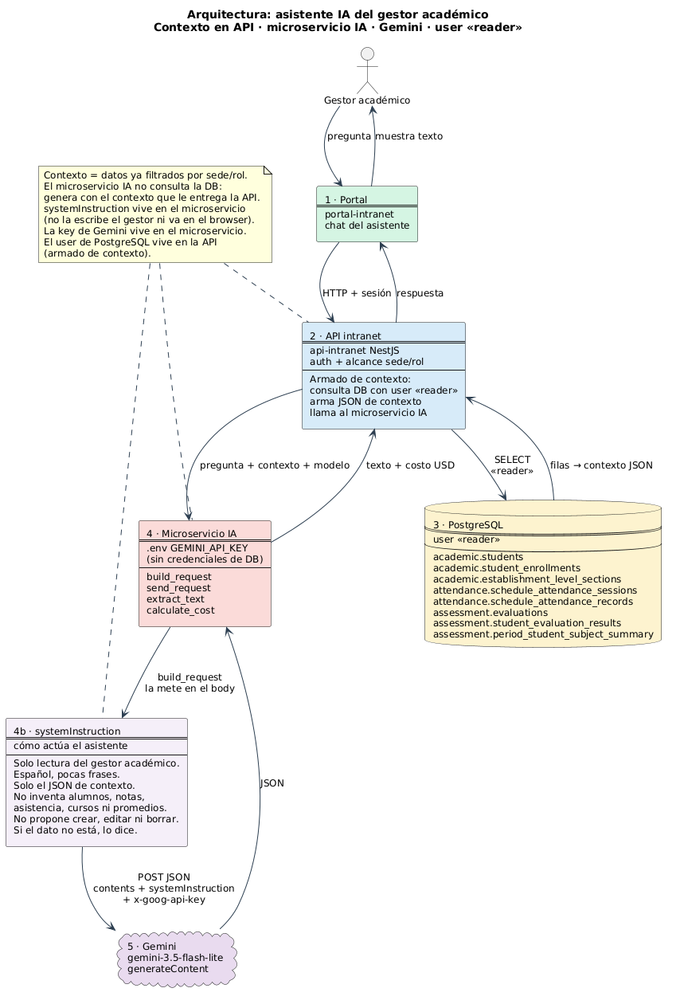

# Decisión de arquitectura: modelo para el asistente del gestor académico

Proyecto: asistente IA de **solo lectura** para el rol *gestor académico* de la intranet escolar (consultas en lenguaje natural sobre notas, asistencia y cursos), consumiendo la API Gemini desde `src/gemini_api.py`.

## Modelo elegido

**`gemini-3.5-flash-lite`**

Fue el más rápido (1,51 s de latencia promedio), el más barato por petición (USD 0,000125) y respondió correctamente 4 de 4 veces, sin reintentos por 429/503 ni timeouts.

## Diagrama de arquitectura

Fuente PlantUML: [`diagrama_arquitectura.puml`](diagrama_arquitectura.puml).

Flujo: el gestor pregunta en el portal → `api-intranet` acota sede y rol, consulta PostgreSQL como `user <<reader>>` y arma el JSON de contexto → `build_request` valida la pregunta, lee `GEMINI_API_KEY` del `.env` y arma el body con **`systemInstruction`** (cómo actúa: solo lectura, no inventa datos, no propone escrituras) más `contents` (pregunta + contexto) → `send_request` hace el POST (Timeout, ConnectionError y JSONDecodeError → `RuntimeError`; 429/503 con backoff) → Gemini tokeniza, genera y detokeniza → JSON con `candidates` y `usageMetadata` → `extract_text` y `calculate_cost`. El login de la base no va en el diagrama.

## Comparación de candidatos

Prueba: `src/compare_models.py`, ejecutado el 21-10-2026 (hora de Chile, UTC-3) desde el PC del desarrollador. Se envió 4 veces **el mismo prompt** a cada modelo: una pregunta de gestor académico con datos ficticios de 4 estudiantes de 2°B («¿qué estudiante tiene promedio bajo 4.0 y asistencia menor a 85%?»). La respuesta correcta es **Diego Soto, promedio 3.7, asistencia 72%**. Los datos completos por petición están en [`resultados-comparacion.json`](resultados-comparacion.json).

Precios: [página oficial de precios de la API Gemini](https://ai.google.dev/gemini-api/docs/pricing), nivel Standard pagado, texto. Consultada el 21-10-2026; la página indica «Last updated 2026-10-19 UTC». Los precios de `gemini-3.8-flash` son promocionales y valen hasta el 31-12-2026 (desde el 01-01-2027 suben a USD 1,50 / 7,50).

| Modelo | Precio entrada / salida (USD por 1M tokens) | Latencia promedio | Costo promedio por petición* | Costo total (4 peticiones)* | Aciertos | Tokens de razonamiento por petición | Reintentos 429/503/timeout |
|---|---|---|---|---|---|---|---|
| **gemini-3.5-flash-lite** | 0,30 / 2,50 | **1,51 s** | **USD 0,000125** | **USD 0,000499** | **4/4** | 0 | 0 |
| gemini-3-flash-preview | 0,50 / 3,00 | 3,76 s | USD 0,000171 | USD 0,000684 | 4/4 | ~554 | 0 |
| gemini-3.8-flash | 0,75 / 3,75 | 16,33 s | USD 0,000243 | USD 0,000971 | 4/4 | ~594 | 5 (en 2 de las 4 peticiones) |

\* `calculate_cost` usa `promptTokenCount` × precio de entrada + `candidatesTokenCount` × precio de salida (210 tokens de entrada por petición en los 3 modelos). **Ojo:** la página de precios aclara que el precio de salida *incluye los tokens de razonamiento* (`thoughtsTokenCount`), y `calculate_cost` no los suma. En `gemini-3.5-flash-lite` no hubo razonamiento, así que su costo es exacto. En los otros dos el costo facturado real es mucho mayor: aprox. **USD 0,00183** por petición en `gemini-3-flash-preview` y **USD 0,00247** en `gemini-3.8-flash`.

Latencia: tiempo solo del intento exitoso, medido con `time.perf_counter` (no cuenta los intentos fallidos ni las esperas del backoff). Incluso las peticiones de `gemini-3.8-flash` que salieron al primer intento tardaron 9,25 s y 12,25 s.

Una ejecución anterior de `gemini-3.5-flash-lite` (U1.2/U1.3) dio un promedio de 10,14 s y USD 0,000044 en total, también con 4/4 correctas, pero con otro prompt y otro momento de carga del servicio. Por eso esos números no se comparan directamente con esta tabla.

### Proyección mensual (50.000 peticiones con este tipo de consulta)

| Modelo | Según `calculate_cost` | Incluyendo tokens de razonamiento |
|---|---|---|
| **gemini-3.5-flash-lite** | **USD 6,24** | **USD 6,24** |
| gemini-3-flash-preview | USD 8,55 | ≈ USD 91,6 |
| gemini-3.8-flash | USD 12,14 | ≈ USD 123,6 (≈ USD 247 desde el 01-01-2027) |

## Justificación

Para el gestor académico pesó más la **latencia junto con la confiabilidad**, y el costo fue el desempate. Las consultas de este rol son cortas y de solo lectura («¿quién está bajo 4.0?», «¿qué asistencia tiene 2°B?») y se hacen en medio del trabajo diario en la intranet, así que la respuesta tiene que llegar en 1 a 2 segundos. Con datos ya entregados en el contexto, la tarea no necesita razonamiento profundo: los tres modelos acertaron 4/4, así que la precisión no los diferenció. Con exactitud empatada, `gemini-3.5-flash-lite` fue entre 2,5 y 10 veces más rápido, fue estable (cero errores de capacidad) y es el más barato: unos USD 6 al mes para 50.000 consultas, frente a USD 90–125 de las alternativas cuando se cuentan los tokens de razonamiento. Además, la página de precios lo describe como optimizado para «high-volume agentic tasks… and simple data processing», que es justo este caso de uso.

## Alternativas descartadas y por qué

- **`gemini-3-flash-preview`**: también acertó 4/4 y no tuvo errores, pero tardó 2,5 veces más (3,76 s) y razonó unos 550 tokens por pregunta, lo que eleva el costo real a unas 15 veces el de flash-lite. Además es un modelo *preview*, que la página de precios llama «legacy», así que puede cambiar o retirarse, y eso no conviene para una herramienta institucional.
- **`gemini-3.8-flash`**: es el Flash más capaz, pero para esta tarea esa capacidad sobra. Fue el más lento (16,33 s de promedio), tuvo 503 «high demand» y timeouts que obligaron a 5 reintentos en 2 de las 4 peticiones, y es el más caro: unos USD 124 al mes, y el doble cuando termine el precio promocional el 31-12-2026.
- *(Probados y fuera de la tabla)* **`gemini-3.1-flash-lite`** no pudo completar las 4 peticiones: devolvió 503 por alta demanda y luego timeout, así que se descartó por inestabilidad. **`gemini-2.5-flash-lite`** respondió 404: «no longer available to new users».
