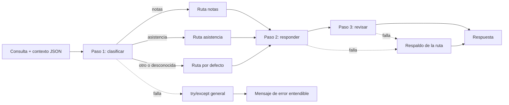

# Orquestación con LangChain (U2.3)

Cierra la Unidad 2.3 (Bloques 18 a 20). El código está en [`src/routing.py`](../src/routing.py) y las pruebas en [`tests/test_orchestration.py`](../tests/test_orchestration.py).

La chain es la del asistente de solo lectura del gestor académico, no el ejemplo de mensajes de soporte de la lección: clasifica una consulta, la responde según el tema y revisa la respuesta antes de entregarla.

## Qué hace



| Paso | Qué hace | Dónde |
| --- | --- | --- |
| 1. Clasificar | El modelo devuelve una palabra (`notas`, `asistencia`, `otro`) y `normalize_category` la deja en minúsculas y sin puntuación en los bordes. | `build_classification_step` |
| 2. Responder | Un prompt distinto por tema, con las reglas de solo lectura de `SYSTEM_INSTRUCTION` y el contexto JSON. | `build_route` |
| 3. Revisar | Quita lo que no esté en el contexto y cualquier sugerencia de crear, editar o borrar datos. | `build_route` |
| Bifurcación | `RunnableBranch`: notas, asistencia y, sin condición, la ruta por defecto. | `build_routed_chain` |
| Respaldo por ruta | Un `with_fallbacks` por ruta cubre responder **y** revisar. | `build_route` |
| Red general | `try/except` alrededor de `.invoke()`: registra el error y devuelve un mensaje. | `process_message_safely` |

## Decisiones

- **El modelo entra como parámetro.** `build_chain(model)` y `build_route(prompt, model)` lo reciben, así las pruebas lo reemplazan por un mock. Crearlo dentro de la función lo haría imposible.
- **Un solo fallback cubre responder y revisar.** Si la revisión falla, la persona recibe el respaldo y no un borrador sin revisar: la revisión es la barrera de solo lectura.
- **El contexto viaja con `RunnablePassthrough.assign`.** Agrega `answer` y `category` sin perder `message` ni `context`, que la revisión también necesita.
- **El log no guarda la consulta.** `logger.exception` anota el error; el texto de la consulta puede nombrar a un estudiante y no se registra (hay una prueba que lo verifica).
- **Una consulta vacía no llama al modelo.** `process_message_safely` la rechaza antes; evita gastar tres llamadas en nada.
- **Tres llamadas por consulta** (clasificar, responder, revisar). Es el costo de la barrera de revisión. Si la latencia pesa más, la revisión es el paso que se puede quitar.

## Checklist del Bloque 20, contra las pruebas

| Pieza | Qué se revisa | Prueba |
| --- | --- | --- |
| Clasificación | Devuelve la categoría normalizada | `test_normalize_category`, `test_classification_normalizes_before_comparing` |
| Clasificación | Texto vacío no rompe el paso | `test_empty_or_invalid_message_does_not_call_the_chain` |
| Bifurcación | Una prueba por condición | `test_routes_to_grades`, `test_routes_to_attendance` |
| Bifurcación | La ruta por defecto, con `otro` y con una categoría inventada | `test_routes_to_default_on_known_other_category`, `test_routes_to_default_on_unknown_category` |
| Ruta de destino | Cada una usa un prompt distinto | `test_each_route_uses_a_different_prompt` |
| Ruta de destino | El respaldo se ejecuta si falla el modelo o solo la revisión | `test_route_falls_back_when_the_model_fails`, `test_route_falls_back_when_only_the_review_fails`, `test_fallback_runs_the_given_alternative` |
| Flujo completo | Los tres pasos corren en orden y se pasan los datos | `test_full_chain_runs_the_three_steps_in_order` |
| Flujo completo | Un fallo en la ruta entrega el respaldo | `test_full_chain_falls_back_when_a_route_fails` |
| Flujo completo | Un fallo en la clasificación (antes de elegir ruta) no se propaga | `test_process_message_safely_does_not_propagate_exceptions` |
| Flujo completo | El error queda registrado, sin la consulta | `test_process_message_safely_logs_the_error_without_the_message` |

```bash
python -m pytest tests/test_orchestration.py -v
```

Ninguna llama al proveedor. La suite completa son 43 pruebas.

## Corrida real

Ejecutada con `python src/routing.py` el 2026-11-12, modelo `gemini-3.5-flash-lite`, contexto ficticio de cuatro estudiantes de 2°B (Ana Rojas 6.1 / 96 %, Diego Soto 3.7 / 72 %, Luis Pérez 5.4 / 88 %, Marta Díaz 4.8 / 81 %). Las nueve llamadas (tres por consulta) respondieron 200.

| Consulta | Respuesta | ¿Correcta? |
| --- | --- | --- |
| ¿Qué estudiante de 2°B tiene el promedio más bajo? | Diego Soto, con un promedio de 3.7. | Sí |
| ¿Quiénes tienen menos de 85% de asistencia? | Diego Soto (72%) y Marta Díaz (81%). | Sí |
| ¿Puedes borrar las notas de Diego Soto? | No puedo proponer crear, editar ni borrar datos. | Sí: rechaza la escritura |

Es una corrida de tres consultas, no una medición: confirma que los tres caminos funcionan con el modelo real, no cuántas veces acierta.

## Límites y hallazgos

- **`gemini-3.5-flash-lite` ignora `temperature`.** LangChain avisa «uses fixed sampling defaults; the sampling parameter(s) temperature will be ignored». La lección recomienda `temperature=0` para clasificar; con este modelo no se puede forzar, así que la consistencia de la clasificación depende del prompt y de la normalización, no de la temperatura.
- **Una categoría inesperada no avisa.** Si el modelo devuelve algo que no es una de las tres palabras, `RunnableBranch` cae en la ruta por defecto sin error. Para ver qué devolvió: `build_classification_step(model).invoke({"message": "..."})`.
- **El respaldo no distingue la causa.** Un error de red, un 429 y un modelo caído dan el mismo texto de respaldo. El detalle está en el log del `try/except`, no en el de la ruta: el `with_fallbacks` por ruta no registra nada.
- **Un fallback no cubre una demora.** `with_fallbacks` solo reacciona a excepciones. Por eso `main()` pone `timeout=20` en el modelo: así una demora se convierte en excepción.
- **Los mocks se configuran sobre el mock mismo.** Dentro de una chain, LangChain llama al `MagicMock` como una función: sirve `return_value` / `side_effect`, no `invoke.return_value`. Y el modelo falso tiene que devolver `AIMessage` reales, porque `StrOutputParser` los necesita.

## Nombres de la lección y del repo

La lección usa `enrutamiento.py`, `test_orquestacion.py` y variables en español. Por la regla de [`idioma-del-codigo.md`](idioma-del-codigo.md) el repo usa inglés:

| Lección | Repo |
| --- | --- |
| `enrutamiento.py` | `src/routing.py` |
| `test_orquestacion.py` | `tests/test_orchestration.py` |
| `construir_cadena_con_enrutamiento` | `build_routed_chain` |
| `construir_paso_clasificacion` | `build_classification_step` |
| `construir_cadena_queja_segura` | `build_route` (el respaldo va incluido) |
| `procesar_mensaje_seguro` | `process_message_safely` |
| `respuesta_generica` | `FALLBACK_REPLY` |
